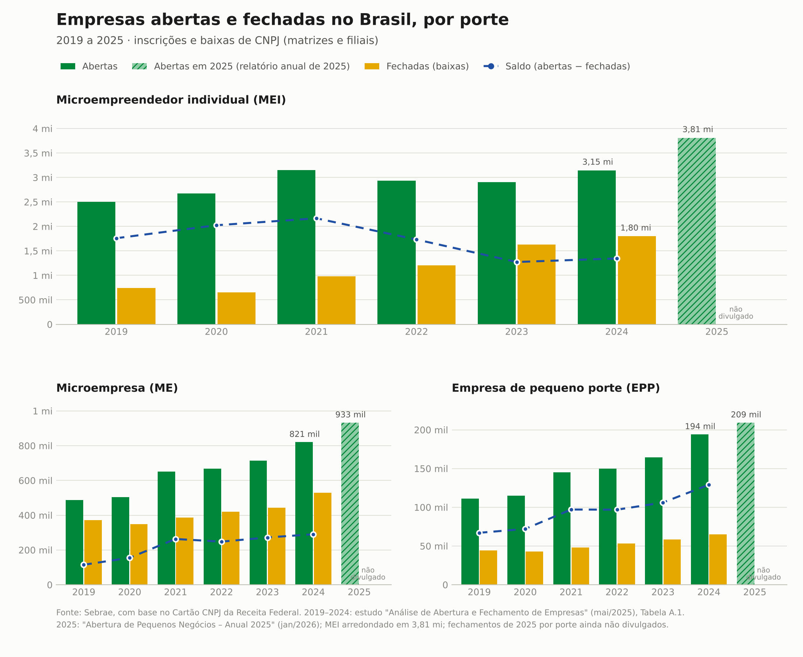
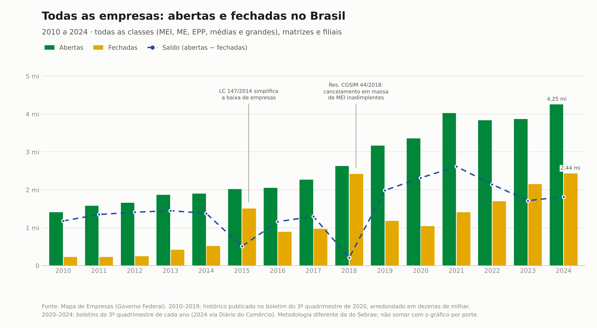

# Abertura e fechamento de empresas no Brasil por porte (MEI, ME, EPP)

Série anual de empresas abertas, fechadas e saldo no Brasil: para todas as empresas do país (2010 a 2024) e separada por porte (2019 a 2025).

**Relatório completo em HTML:** [`saida/relatorio.html`](saida/relatorio.html) junta os dois gráficos (interativos), as tabelas, as fontes e as notas de leitura num único arquivo que abre sem internet. Para vê-lo publicado, ative o GitHub Pages no repositório ou baixe o arquivo e abra no navegador.

Os dados estão em CSV versionado, cada número aponta para a publicação de onde saiu e um teste automatizado confere os valores contra os totais publicados.



## Todas as empresas



Totais de todas as classes de empresa (MEI, ME, EPP, médias e grandes), segundo o **Mapa de Empresas** do Governo Federal, de 2010 a 2024. As aberturas triplicaram no período (de 1,41 mi para 4,25 mi). Os fechamentos cresceram ainda mais rápido, de 0,23 mi para 2,44 mi, e o saldo caiu de 2,62 mi em 2021 para 1,82 mi em 2024.

Dois picos de fechamento têm causa administrativa, segundo o próprio boletim:

- **2015**: a LC 147/2014 simplificou a baixa de empresas, e muitas que já não funcionavam foram encerradas formalmente.
- **2018**: a Resolução CGSIM nº 44/2018 permitiu cancelar em massa MEI inadimplentes.

De 2010 a 2019 os números vêm do histórico publicado no boletim de 2020, com rótulos em milhões e duas casas decimais (precisão de dezenas de milhar). O CSV marca esses anos como aproximados.

**Por que não há um painel só de médias e grandes empresas ("Demais")?** Nenhuma fonte aberta publica aberturas *e* fechamentos dessa classe por ano. O Sebrae exclui as "Demais" do estudo de fechamentos, e o Mapa de Empresas só separa o MEI do resto. Subtrair um do outro não funciona: as metodologias diferem a ponto de a diferença dar negativa nos fechamentos de 2021. A única referência é a de aberturas de 2025 do Sebrae: 5,14 mi empresas no total contra 4,95 mi pequenos negócios, ou seja, cerca de 190 mil médias e grandes.

## O que os dados mostram

- **MEI**: as aberturas seguem altas, mas os fechamentos mais que dobraram entre 2019 e 2024 (de 744 mil para 1,80 milhão). O saldo caiu de 2,17 milhões em 2021 para cerca de 1,3 milhão em 2023 e 2024.
- **ME e EPP**: o saldo cresce de forma contínua. As aberturas de 2025 foram as maiores da série nos três portes.
- **Atenção**: parte da alta nos fechamentos de MEI vem de ações da Receita Federal (depuração cadastral, baixas de ofício de inadimplentes), não só de empresas que pararam de funcionar. O próprio Sebrae aponta esses marcos: fev–mar/2021, nov–dez/2022, out–dez/2023 e ago–set/2024.

## Fontes

| ID | Publicação | Onde está o número | Base de dados |
|---|---|---|---|
| `sebrae_2019_2024` | Sebrae Nacional, *Relatório Técnico: Análise de Abertura e Fechamento de Empresas por Setor e CNAE no Brasil* (16/05/2025) | Apêndice, Tabela A.1, p. 35 | Cartão CNPJ da Receita Federal, extraído em 07/04/2025 |
| `sebrae_aberturas_2025` | Sebrae Nacional, *Resumo Executivo: Abertura de Pequenos Negócios – Anual 2025* (13/01/2026) | Seção "Análise de 2025", p. 5 | Cartão CNPJ da Receita Federal, extraído em 07/01/2026 |

| `mapa_2020` a `mapa_2024` | Mapa de Empresas (Governo Federal), boletins do 3º quadrimestre de cada ano | Totais anuais ("GERAL"). 2024 vem de reportagem do Diário do Comércio que reproduz o boletim, porque o PDF oficial não estava acessível | Juntas comerciais e Receita Federal (Redesim) |

Links:

- [Análise de Abertura e Fechamento de Empresas 2019–2024 (PDF)](https://sebraepr.com.br/wp-content/uploads/2025/09/PUB_Analise-de-Abertura-e-Fechamento-de-Empresas-por-Setor-e-CNAE-no-Brasil-2019-2024.pdf)
- [Abertura de Pequenos Negócios – Anual 2025 (PDF)](https://datasebrae.com.br/wp-content/uploads/2026/01/13012026_resumo_executivo_aberturas_pn_anual.pdf)

- Mapa de Empresas: [2020](https://www.gov.br/empresas-e-negocios/pt-br/mapa-de-empresas/boletins/mapa-de-empresas-boletim-3o-quadrimestre-2020.pdf), [2021](https://www.gov.br/empresas-e-negocios/pt-br/mapa-de-empresas/boletins/mapa-de-empresas-boletim-3o-quadrimestre-2021.pdf), [2022](https://www.gov.br/empresas-e-negocios/pt-br/mapa-de-empresas/boletins/mapa-de-empresas-boletim-3o-quadrimestre-2022.pdf), [2023](https://www.gov.br/empresas-e-negocios/pt-br/mapa-de-empresas/boletins/mapa-de-empresas-boletim-3o-quadrimestre-2023.pdf), [2024 (via Diário do Comércio)](https://diariodocomercio.com.br/economia/saldo-de-empresas-em-minas-gerais-e-positivo-em-2024/)

A mesma lista está em [`dados/fontes.csv`](dados/fontes.csv), e cada linha de [`dados/abertura_fechamento_por_porte.csv`](dados/abertura_fechamento_por_porte.csv) indica qual fonte usou para abertas e para fechadas.

## Metodologia (resumo da fonte)

- **Abertura** = inscrição de CNPJ no ano (data de cadastro). **Fechamento** = CNPJ com situação "baixada" no ano. Incluem matrizes e filiais.
- **MEI**: empresa optante pelo MEI na data da abertura (para aberturas) ou na data da baixa (para fechamentos).
- **ME e EPP**: porte declarado no CNPJ. Empresas de porte "Demais" optantes do Simples Nacional na abertura foram reclassificadas como EPP. Empresas grandes, fora do MEI e do Simples, não entram.
- Só empresas mercantis: ficam de fora administração pública, associações e organismos internacionais.
- **Saldo** = abertas − fechadas no ano. Não é o estoque de empresas ativas, porque ignora empresas inaptas, suspensas e o estoque de anos anteriores.

## Limitações

- **2025 está incompleto**: só as aberturas por porte foram publicadas até out/2026. Os fechamentos de 2025 por porte ainda não foram divulgados de forma aberta, por isso não há barra de fechadas nem saldo em 2025.
- **MEI 2025 é aproximado**: o relatório traz "cerca de 3,81 milhões"; o CSV marca essa linha com `abertas_aproximado = true`.
- **2025 vem de outra extração da base** (jan/2026, contra abr/2025 da série 2019–2024). Os números de anos anteriores podem mudar um pouco entre extrações, porque baixas e reclassificações são registradas com atraso. Por isso 2025 aparece hachurado no gráfico.
- Os dois gráficos usam fontes diferentes e **não devem ser somados nem subtraídos**: o Mapa de Empresas inclui todos os portes e outras naturezas jurídicas, e conta as baixas de outra forma.
- O gráfico de todas as empresas começa em 2010, primeiro ano do histórico do Mapa de Empresas, e termina em 2024: o boletim com o total anual de 2025 não foi localizado.
- **Antes de 2009 não há MEI** (criado pela LC 128/2008) e o Simples Nacional começou em julho de 2007. Uma série por porte desde 2000 só seria possível reconstruindo a base aberta de CNPJ da Receita Federal, com a ressalva de que o porte registrado é o atual, não o da época.

## Como usar

Requer Python 3.10+.

```bash
python -m venv .venv
source .venv/bin/activate      # no Windows: .venv\Scripts\activate
pip install -r requirements.txt

python -m empresas_porte        # gera os gráficos (PNG e SVG), saida/tabela.md e saida/relatorio.html
pytest                          # confere os dados contra os totais publicados
```

Para usar os dados em outro código:

```python
from empresas_porte import carregar_dados, abreviar

df = carregar_dados()           # colunas: ano, porte, abertas, fechadas, saldo, fontes...
mei = df[df["porte"] == "MEI"]
print(abreviar(mei["fechadas"].max()))   # '1,80 mi'
```

## Estrutura

```
dados/
  abertura_fechamento_por_porte.csv   # os números, um por ano e porte (Sebrae)
  todas_empresas.csv                  # totais de todas as empresas (Mapa de Empresas)
  fontes.csv                          # de onde saiu cada número
empresas_porte/
  dados.py                            # leitura e cálculo do saldo
  formatacao.py                       # números no padrão brasileiro (1.234.567, "1,2 mi")
  grafico.py                          # gráficos estáticos (PNG/SVG) com as cores da bandeira
  relatorio.py                        # relatório HTML único e interativo
  vendor/chart.umd.js                 # Chart.js 4.4.1 (MIT), embutido no HTML
  __main__.py                         # linha de comando
tests/test_dados.py                   # confere somas e saldos com Sebrae e Mapa de Empresas
saida/                                # gráfico e tabela gerados
```

## Tabela completa

Gerada por `python -m empresas_porte` em [`saida/tabela.md`](saida/tabela.md).

## Atualizando para 2025 ou anos seguintes

1. Quando o Sebrae publicar os fechamentos por porte, preencha a coluna `fechadas` das linhas de 2025 e informe a fonte em `fonte_fechadas`.
2. Acrescente a nova publicação em `dados/fontes.csv`.
3. Se a fonte trouxer totais de Pequenos Negócios, adicione-os em `tests/test_dados.py`.
4. Rode `pytest` e `python -m empresas_porte`.

## Licença

Código sob licença MIT. O Chart.js embutido também é MIT (ver `empresas_porte/vendor/CHARTJS_LICENSE.md`). Os dados são do Sebrae, a partir de dados públicos da Receita Federal; cite as fontes acima ao reutilizá-los.
