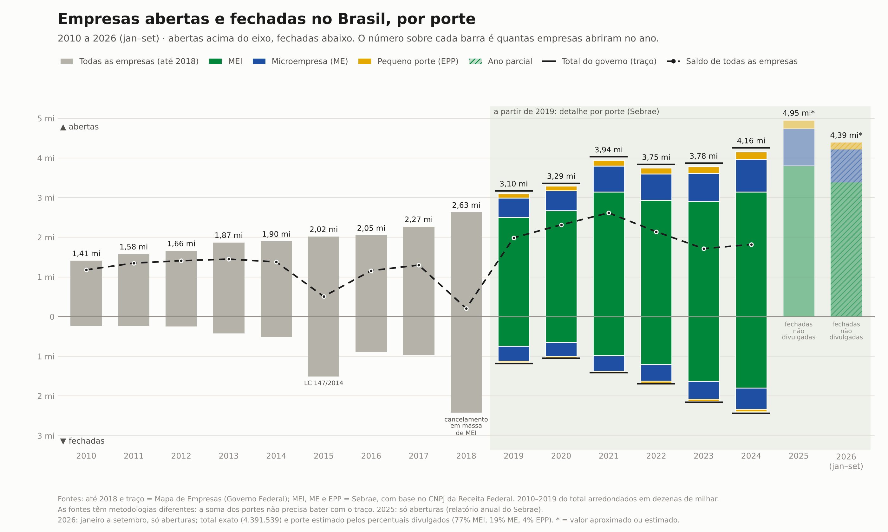

# Abertura e fechamento de empresas no Brasil por porte (MEI, ME, EPP)

Série anual de empresas abertas, fechadas e saldo no Brasil: para todas as empresas do país (2010 a 2024) e separada por porte (2019 a 2025, mais 2026 de janeiro a setembro).

**Relatório completo em HTML:** [`saida/relatorio.html`](saida/relatorio.html) junta os gráficos (interativos), as tabelas, as fontes e as notas de leitura num único arquivo que abre sem internet. Para vê-lo publicado, ative o GitHub Pages no repositório ou baixe o arquivo e abra no navegador.

Os dados estão em CSV versionado, cada número aponta para a publicação de onde saiu e um teste automatizado confere os valores contra os totais publicados.

## Gráfico principal: tudo junto



Abertas acima do eixo e fechadas abaixo, de 2010 a 2026 (jan–set), com o número de empresas abertas sobre cada barra. Até 2018 só existe o total do Mapa de Empresas (cinza). De 2019 em diante, as barras mostram MEI, ME e EPP empilhados (Sebrae), e um traço preto marca o total do Mapa de Empresas no mesmo ano. Como as fontes têm metodologias diferentes, a soma dos portes fica um pouco abaixo do traço (cerca de 2% nas aberturas). Em 2025 só há aberturas; 2026 é parcial (janeiro a setembro) e aparece com contorno tracejado no relatório e hachurado na imagem.

## Todas as empresas


Totais de todas as classes de empresa (MEI, ME, EPP, médias e grandes), segundo o **Mapa de Empresas** do Governo Federal, de 2010 a 2024. As aberturas triplicaram no período (de 1,41 mi para 4,25 mi). Os fechamentos cresceram ainda mais rápido, de 0,23 mi para 2,44 mi, e o saldo caiu de 2,62 mi em 2021 para 1,82 mi em 2024.

Dois picos de fechamento têm causa administrativa, segundo o próprio boletim:

- **2015**: a LC 147/2014 simplificou a baixa de empresas, e muitas que já não funcionavam foram encerradas formalmente.
- **2018**: a Resolução CGSIM nº 44/2018 permitiu cancelar em massa MEI inadimplentes.

De 2010 a 2019 os números vêm do histórico publicado no boletim de 2020, com rótulos em milhões e duas casas decimais (precisão de dezenas de milhar). O CSV marca esses anos como aproximados.

**Por que não há um painel só de médias e grandes empresas ("Demais")?** Nenhuma fonte aberta publica aberturas *e* fechamentos dessa classe por ano. O Sebrae exclui as "Demais" do estudo de fechamentos, e o Mapa de Empresas só separa o MEI do resto. Subtrair um do outro não funciona: as metodologias diferem a ponto de a diferença dar negativa nos fechamentos de 2021. A única referência é a de aberturas de 2025 do Sebrae: 5,14 mi empresas no total contra 4,95 mi pequenos negócios, ou seja, cerca de 190 mil médias e grandes.

## Detalhe por porte

Cada porte na sua própria escala, para ver a tendência dos menores, que no gráfico principal ficam finos.


## O que os dados mostram

- **MEI**: as aberturas seguem altas, mas os fechamentos mais que dobraram entre 2019 e 2024 (de 744 mil para 1,80 milhão). O saldo caiu de 2,17 milhões em 2021 para cerca de 1,3 milhão em 2023 e 2024.
- **ME e EPP**: o saldo cresce de forma contínua. As aberturas de 2025 foram as maiores da série nos três portes.
- **Atenção**: parte da alta nos fechamentos de MEI vem de ações da Receita Federal (depuração cadastral, baixas de ofício de inadimplentes), não só de empresas que pararam de funcionar. O próprio Sebrae aponta esses marcos: fev–mar/2021, nov–dez/2022, out–dez/2023 e ago–set/2024.

## Fontes

| ID | Publicação | Onde está o número | Base de dados |
|---|---|---|---|
| `sebrae_2019_2024` | Sebrae Nacional, *Relatório Técnico: Análise de Abertura e Fechamento de Empresas por Setor e CNAE no Brasil* (16/05/2025) | Apêndice, Tabela A.1, p. 35 | Cartão CNPJ da Receita Federal, extraído em 07/04/2025 |
| `sebrae_aberturas_2025` | Sebrae Nacional, *Resumo Executivo: Abertura de Pequenos Negócios – Anual 2025* (13/01/2026) | Seção "Análise de 2025", p. 5 | Cartão CNPJ da Receita Federal, extraído em 07/01/2026 |
| `sebrae_aberturas_2026_set` | Levantamento do Sebrae divulgado em 07/10/2026 (via Portal Contábeis) | Acumulado jan–set/2026 e percentuais por porte | Cartão CNPJ da Receita Federal |
| `mapa_2020` a `mapa_2024` | Mapa de Empresas (Governo Federal), boletins do 3º quadrimestre de cada ano | Totais anuais, linha "GERAL" (em 2024, Tabela 27) | Juntas comerciais e Receita Federal (Redesim) |

Links:

- [Análise de Abertura e Fechamento de Empresas 2019–2024 (PDF)](https://sebraepr.com.br/wp-content/uploads/2025/09/PUB_Analise-de-Abertura-e-Fechamento-de-Empresas-por-Setor-e-CNAE-no-Brasil-2019-2024.pdf)
- [Abertura de Pequenos Negócios – Anual 2025 (PDF)](https://datasebrae.com.br/wp-content/uploads/2026/01/13012026_resumo_executivo_aberturas_pn_anual.pdf)

- Mapa de Empresas: [2020](https://www.gov.br/empresas-e-negocios/pt-br/mapa-de-empresas/boletins/mapa-de-empresas-boletim-3o-quadrimestre-2020.pdf), [2021](https://www.gov.br/empresas-e-negocios/pt-br/mapa-de-empresas/boletins/mapa-de-empresas-boletim-3o-quadrimestre-2021.pdf), [2022](https://www.gov.br/empresas-e-negocios/pt-br/mapa-de-empresas/boletins/mapa-de-empresas-boletim-3o-quadrimestre-2022.pdf), [2023](https://www.gov.br/empresas-e-negocios/pt-br/mapa-de-empresas/boletins/mapa-de-empresas-boletim-3o-quadrimestre-2023.pdf), [2024](https://www.gov.br/empresas-e-negocios/pt-br/mapa-de-empresas/boletins/boletim-do-mapa-de-empresas-3o-quad-2024.pdf)

A mesma lista está em [`dados/fontes.csv`](dados/fontes.csv), e cada linha de [`dados/abertura_fechamento_por_porte.csv`](dados/abertura_fechamento_por_porte.csv) indica qual fonte usou para abertas e para fechadas.

## Fontes primárias e como atualizar

Os números acima vêm de publicações (boletins e relatórios em PDF). As três plataformas abaixo são de onde essas publicações saem, e servem para conferir, detalhar ou completar a série.

### 1. Mapa de Empresas (Governo Federal)

- **Onde:** [Mapa de Empresas](https://www.gov.br/empresas-e-negocios/pt-br/mapa-de-empresas) e [Painéis do Mapa de Empresas](https://www.gov.br/empresas-e-negocios/pt-br/mapa-de-empresas/painel-mapa-de-empresas). Tempos de abertura também em [Estatísticas REDESIM](https://estatistica.redesim.gov.br/tempos-abertura).
- **O que tem:** painéis mensais de empresas abertas e fechadas por município, atividade, natureza jurídica e porte, além do tempo médio de abertura. Os boletins quadrimestrais usados aqui são o resumo oficial desses painéis.
- **Como extrair:** os painéis são interativos e não têm API. O [manual oficial](https://www.gov.br/empresas-e-negocios/pt-br/mapa-de-empresas/arquivos/MANUALMAPADEEMPRESASv2.pdf/@@display-file/file) explica: aplique os filtros, abra o menu do gráfico ou da tabela, escolha "Baixar como…" e depois "Dados". Salve a exportação em `dados/brutos/mapa_de_empresas/` com a data da extração no nome.
- **Atenção:** desde dezembro de 2025 o tempo de abertura subiu por causa do novo fluxo de inscrição do CNPJ; compare tempos antigos e novos com cautela.

### 2. DataSebrae (Sebrae Nacional)

- **Onde:** [DataSebrae](https://datasebrae.com.br/), [tema Empresas](https://datasebrae.com.br/empresas/) e [Painel de Fechamento de Empresas](https://datasebrae.com.br/painel-de-fechamento-de-empresas/).
- **O que tem:** aberturas, fechamentos e saldo por MEI, ME e EPP, por estado e setor, e os relatórios em PDF usados neste projeto.
- **Como extrair:** o painel de fechamento é um relatório Power BI público; quando a opção estiver habilitada, use "Exportar dados" no menu do visual. É a fonte mais provável para os fechamentos de 2025 por porte, que ainda faltam aqui.

### 3. Base aberta de CNPJ (Receita Federal, via Portal de Dados Abertos)

- **Onde:** [Portal Brasileiro de Dados Abertos](https://dados.gov.br/dados/conjuntos-dados/cadastro-nacional-da-pessoa-juridica---cnpj), com os arquivos em [arquivos.receitafederal.gov.br](https://arquivos.receitafederal.gov.br/dados/cnpj/dados_abertos_cnpj/) e o [dicionário de dados](https://www.gov.br/receitafederal/dados/cnpj-metadados.pdf).
- **O que tem:** o cadastro completo, atualizado todo mês: estabelecimentos ativos e baixados, empresas (porte e natureza jurídica), opção pelo Simples e pelo MEI com datas, e sócios.
- **Como usar aqui:** o módulo `empresas_porte.receita` refaz a conta do Sebrae a partir dessa base, por ano e porte (MEI, ME, EPP e Demais), desde 2000. Isso preenche o que as publicações não trazem: fechamentos de 2025 por porte, anos anteriores a 2019 e as médias e grandes empresas.

```bash
pip install -r requirements.txt                                      # inclui o DuckDB
python -m empresas_porte.receita baixar 2026-09 --pasta ~/cnpj/2026-09   # alguns GB em zip
python -m empresas_porte.receita processar --pasta ~/cnpj/2026-09        # grava dados/receita_cnpj_por_porte.csv
```

A base descompactada ocupa dezenas de GB, por isso o processamento roda na sua máquina, não no repositório. O resultado sai com dois recortes: `mercantil` (o mesmo do Sebrae, para comparar com a série 2019–2024) e `todas` (sem filtro, para comparar com o Mapa de Empresas). Limitações: o porte ME/EPP é o atual, não o da época, e a base é uma foto do cadastro no mês escolhido. O processamento é testado com uma amostra sintética no mesmo layout da Receita (`tests/test_receita.py`).

## Metodologia (resumo da fonte)

- **Abertura** = inscrição de CNPJ no ano (data de cadastro). **Fechamento** = CNPJ com situação "baixada" no ano. Incluem matrizes e filiais.
- **MEI**: empresa optante pelo MEI na data da abertura (para aberturas) ou na data da baixa (para fechamentos).
- **ME e EPP**: porte declarado no CNPJ. Empresas de porte "Demais" optantes do Simples Nacional na abertura foram reclassificadas como EPP. Empresas grandes, fora do MEI e do Simples, não entram.
- Só empresas mercantis: ficam de fora administração pública, associações e organismos internacionais.
- **Saldo** = abertas − fechadas no ano. Não é o estoque de empresas ativas, porque ignora empresas inaptas, suspensas e o estoque de anos anteriores.

## Limitações

- **2025 está incompleto**: só as aberturas por porte foram publicadas até out/2026. Os fechamentos de 2025 por porte ainda não foram divulgados em relatório, por isso não há barra de fechadas nem saldo em 2025. Eles podem ser obtidos pelo painel de fechamento do DataSebrae ou calculados com `empresas_porte.receita` (veja "Fontes primárias").
- **2026 é parcial e o porte é estimado**: o Sebrae divulgou o total exato de pequenos negócios abertos de janeiro a setembro de 2026 (4.391.539) e só os percentuais por porte (77% MEI, 19% ME, 4% EPP). Os valores por porte no CSV aplicam esses percentuais ao total e estão marcados com `abertas_aproximado = true` e `periodo = jan-set`. Não compare a barra de 2026 com anos completos sem considerar que faltam três meses.
- **MEI 2025 é aproximado**: o relatório traz "cerca de 3,81 milhões"; o CSV marca essa linha com `abertas_aproximado = true`.
- **2025 vem de outra extração da base** (jan/2026, contra abr/2025 da série 2019–2024). Os números de anos anteriores podem mudar um pouco entre extrações, porque baixas e reclassificações são registradas com atraso. Por isso 2025 aparece hachurado no gráfico.
- Os dois gráficos usam fontes diferentes e **não devem ser somados nem subtraídos**: o Mapa de Empresas inclui todos os portes e outras naturezas jurídicas, e conta as baixas de outra forma.
- O gráfico de todas as empresas começa em 2010, primeiro ano do histórico do Mapa de Empresas, e termina em 2024: o boletim com o total anual de 2025 não foi localizado.
- **Antes de 2009 não há MEI** (criado pela LC 128/2008) e o Simples Nacional começou em julho de 2007. Uma série por porte desde 2000 pode ser reconstruída com `empresas_porte.receita`, com a ressalva de que o porte registrado é o atual, não o da época.

## Como usar

Requer Python 3.10+.

```bash
python -m venv .venv
source .venv/bin/activate      # no Windows: .venv\Scripts\activate
pip install -r requirements.txt

python -m empresas_porte        # gera os gráficos (PNG e SVG), saida/tabela.md e saida/relatorio.html
pytest                          # confere os dados contra os totais publicados
```

Para usar os dados em outro código:

```python
from empresas_porte import carregar_dados, abreviar

df = carregar_dados()           # colunas: ano, porte, abertas, fechadas, saldo, fontes...
mei = df[df["porte"] == "MEI"]
print(abreviar(mei["fechadas"].max()))   # '1,80 mi'
```

## Estrutura

```
dados/
  abertura_fechamento_por_porte.csv   # os números, um por ano e porte (Sebrae)
  todas_empresas.csv                  # totais de todas as empresas (Mapa de Empresas)
  fontes.csv                          # de onde saiu cada número
empresas_porte/
  dados.py                            # leitura e cálculo do saldo
  formatacao.py                       # números no padrão brasileiro (1.234.567, "1,2 mi")
  combinado.py                        # gráfico principal: total desde 2010 + porte empilhado
  grafico.py                          # gráficos estáticos (PNG/SVG) com as cores da bandeira
  relatorio.py                        # relatório HTML único e interativo
  receita.py                          # processa a base aberta de CNPJ da Receita (roda local)
  vendor/chart.umd.js                 # Chart.js 4.4.1 (MIT), embutido no HTML
  __main__.py                         # linha de comando
tests/test_dados.py                   # confere somas e saldos com Sebrae e Mapa de Empresas
tests/test_receita.py                 # testa o processamento da base de CNPJ com amostra sintética
saida/                                # gráfico e tabela gerados
```

## Tabela completa

Gerada por `python -m empresas_porte` em [`saida/tabela.md`](saida/tabela.md).

## Atualizando para 2025 ou anos seguintes

1. Quando tiver os fechamentos de 2025 por porte (relatório do Sebrae, exportação do painel do DataSebrae ou `empresas_porte.receita`), preencha a coluna `fechadas` das linhas de 2025 e informe a fonte em `fonte_fechadas`.
2. Acrescente a nova publicação em `dados/fontes.csv`.
3. Se a fonte trouxer totais de Pequenos Negócios, adicione-os em `tests/test_dados.py`.
4. Rode `pytest` e `python -m empresas_porte`.

## Licença

Código sob licença MIT. O Chart.js embutido também é MIT (ver `empresas_porte/vendor/CHARTJS_LICENSE.md`). Os dados são do Sebrae e do Mapa de Empresas, a partir de dados públicos da Receita Federal; cite as fontes acima ao reutilizá-los.
